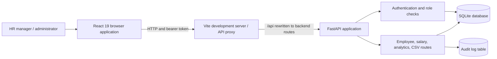
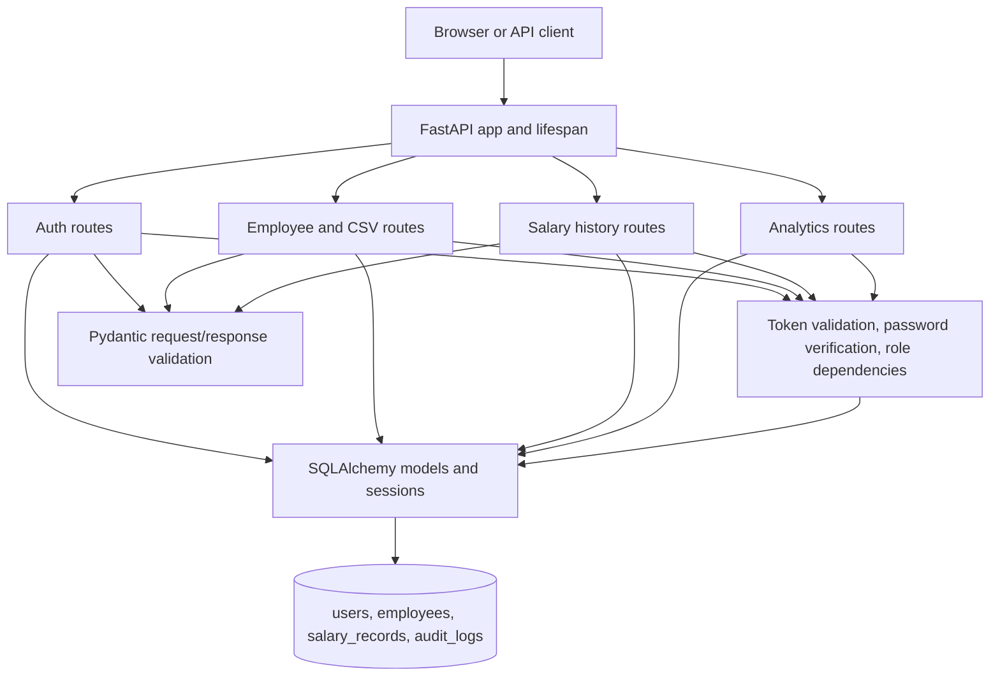
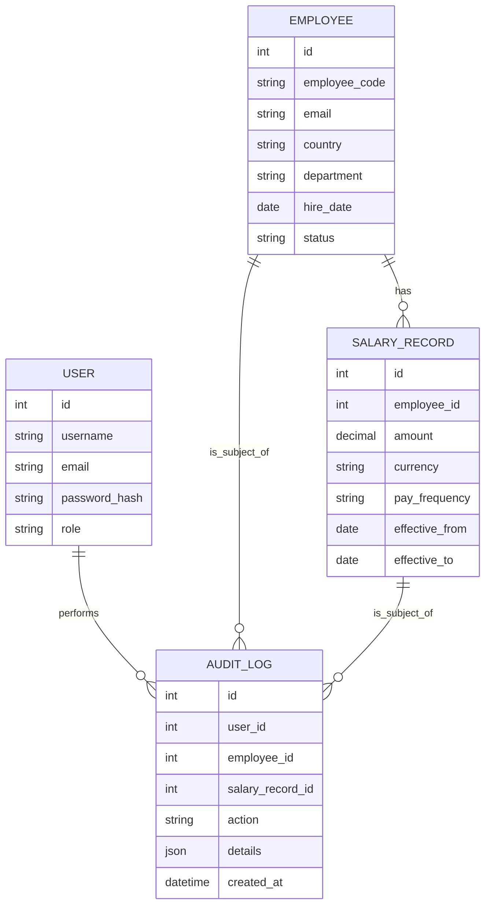

# Architecture

## System context

In local development, Vite proxies `/api/*` and `/health` to the API at `http://localhost:8000`. The frontend can be configured with `VITE_API_URL` for a different API base URL. Production hosting and proxy/TLS configuration are deployment concerns and are not defined by this local Vite setup.

## Backend component view

## Core data relationships

## Request and mutation flow

1. FastAPI resolves the database session and the current user for protected routes.
2. Route dependencies enforce the allowed role before business operations.
3. Pydantic schemas validate request shape and field constraints.
4. Route logic enforces cross-record rules, such as hire date and salary-period consistency.
5. SQLAlchemy persists business changes and their audit record in the same transaction where implemented.
6. Response models or explicit route payloads return the result; errors use explicit HTTP status codes.

## Operational notes

- Database setup currently creates tables through SQLAlchemy metadata during app startup; this is not a substitute for a production migration/backup plan.
- SQLite foreign-key enforcement is enabled on each connection.
- The backend's current database module selects its SQLite file directly; configure-and-migrate for a server database before multi-instance production deployment.
